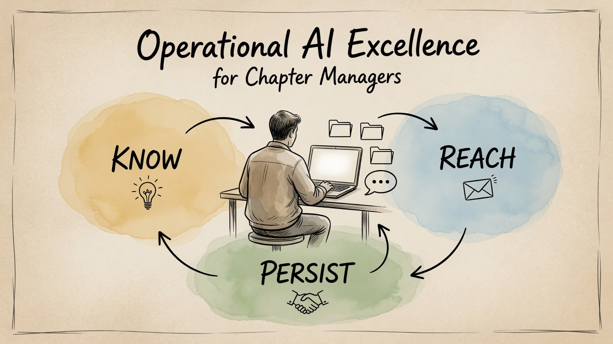

# Best Practice — YPO Chapter Managers & AI · v0.2

> **The fastest way: give this kit to your AI**
>
> Your AI tool can walk you through the whole setup — step by step, for your computer, your tools and your questions.
> No GitHub account, no plugin, no connector. Start with Way 1:
>
> **Way 1 — everyone.** Open a new chat in your paid AI tool (Claude, ChatGPT, Copilot, Gemini …) and paste this one sentence:
>
> ```text
> Read https://raw.githubusercontent.com/kirchbergcapital/ypo-chapter-manager-best-practice/main/AI-GUIDE.md and guide me step by step.
> ```
>
> **Best with a desktop app.** In the ChatGPT or Claude desktop app, open **one** new, empty folder for your chapter work — ideally inside your OneDrive or Google Drive folder on the laptop, for example `YPO` (ChatGPT: Work · Claude: Cowork `[verify the menu name]`) — then paste the same sentence. Your assistant builds your chapter folder inside it and saves every file itself — no downloads, no copying.
>
> If your AI says it cannot open links, use Way 2.
>
> **Way 2 — if your AI cannot open links.** Download the starter file, no account needed:
> [KIT-START.txt](https://raw.githubusercontent.com/kirchbergcapital/ypo-chapter-manager-best-practice/main/KIT-START.txt) — about 100 KB (right-click → "Save link as", or open it and save it).
> **Attach** it to a new chat — paperclip or drag and drop; don't paste its text into the message box, that is too long for a chat — and say:
>
> ```text
> This is my kit. Read the AI guide section first and guide me step by step.
> ```
>
> The rest of the kit comes as seven more chat files (`KIT-2-…` to `KIT-8-…`, same place). Your AI tells you which one it needs, when it needs it — one at a time. With a desktop app, save the file in a subfolder `_kit` of that one folder, open the one folder and say: `Read _kit/KIT-START.txt and guide me step by step.` Your assistant builds the chapter folder next to `_kit`.
>
> **Way 3 — the whole kit in one folder** (desktop app with a folder, and for building things such as the WhatsApp app — with ChatGPT Work, Claude Cowork, Codex or Claude Code).
> Download the kit as one file, [`_kit.zip`](https://github.com/kirchbergcapital/ypo-chapter-manager-best-practice/releases/latest/download/_kit.zip) — no account needed, always the latest version.
> Unzip it inside that one folder (Windows: right-click → *Extract All*; Mac: double-click) — you get a folder `_kit` (named `_kit (1)` or `_kit 2`? rename it to `_kit`). Open the one folder in your AI app (desktop app: *Best with a desktop app* above) and say:
>
> ```text
> Read _kit/AI-GUIDE.md and guide me.
> ```
>
> **Keep it up to date.** Same link, always the newest version. Rename your old `_kit` to `_kit-old`, unzip the new `_kit.zip` in the same place, and delete `_kit-old` once the new `_kit` holds `AI-GUIDE.md`. Your chapter folder stays.
>
> **Two prerequisites:** a paid AI plan, and chapter accounts in Microsoft 365 or Google Workspace — at least `manager@` for you
> and `chair@` for your Chair, so the handover works and the Chair can read the chapter folder. If one is missing, that is where your AI starts.
> *For AI tools:* follow [`AI-GUIDE.md`](AI-GUIDE.md) — § 0 says how to read this kit.



<sub>Illustration generated with Grok (xAI) for this kit.</sub>

**A community kit: practical and AI-ready, for YPO Chapter Managers.**
Chairs and officers rotate every year; the Chapter Manager stays. This kit helps you become — and keep — the memory
of your chapter, with an AI assistant doing the filing, the first drafts and the handover notes. Designed to fit into the hours you already have.
The bet behind it: the hours come from searching and answering things twice. Test it with your own week — [your log](10-time-by-area/) shows it.

> **Community resource by a YPO member, not an official YPO resource.** Where YPO rules apply, your Regional Manager
> and the official YPO resources are the reference. No YPO logos, no member data, no confidential content inside.
> Version 0.2 (draft), October 2026.
> **Maintainer:** Josef Schneider · **last checked:** 21 Oct 2026 · menus move — every tool page carries an as-of date.

**What this kit is — and how it fits the workshop.**
This kit is the companion to the workshop format **Operational AI Excellence for Chapter Managers**: one fixed format, the same in every room —
120 minutes (with a 90-minute version), three blocks along the three questions below (*Know · Reach · Persist*) and hands-on labs
in the ChatGPT or Claude desktop app. In the workshop you build the first pieces with your own chapter work; the kit holds everything
for the next steps — modules, word-for-word prompts, templates and a fictional example chapter, *Lakeside*.
You can also use it on its own, without attending: your AI tool walks you through it, station by station, at your own pace.
Trainers and RAOs who want to run the format themselves find the minute plan, the demos and the slides in [`trainer/`](https://github.com/kirchbergcapital/ypo-chapter-manager-best-practice/tree/main/trainer) (online only).

The kit grows with use. Chapter Managers test it in their own week, and what works — or does not — goes into the next version
([`CHANGELOG.md`](CHANGELOG.md)). Ideas and corrections are welcome: see [Contributions](CHANGELOG.md#contributions-from-chapter-managers).

**Something just landed on your desk?** [`SITUATIONS.md`](SITUATIONS.md) starts from the situation — a full inbox, a new officer, an event, a stand-in, a question about your workload — and names the file and the prompt that help.

## Who it is for

| You are | Start with |
|---|---|
| **Chapter Manager** | [`START-HERE.md`](START-HERE.md) — your path, step by step |
| **Chair, Chair Elect or officer** | [`06-chapter-rules/`](06-chapter-rules/) (one-page AI rules, guardrails) and [`05-officer-handover/`](05-officer-handover/) |
| **AI assistant** of a Chapter Manager | [`START-HERE.md`](START-HERE.md), then [`02-your-assistant/cm-assistant-instructions.md`](02-your-assistant/cm-assistant-instructions.md) |
| **Trainer or RAO** who wants to run the workshop | [`trainer/run-it-yourself.md`](https://github.com/kirchbergcapital/ypo-chapter-manager-best-practice/tree/main/trainer/run-it-yourself.md) |

## The three questions this kit answers

| # | Question | Folder |
|---|---|---|
| 1 | **Reach** — how do I reach my members by email and WhatsApp without drowning? | [`03-communication`](03-communication/) |
| 2 | **Know** — how do I build a knowledge base my AI can answer from, with automation where it helps? | [`02-your-assistant`](02-your-assistant/), [`04-knowledge-base`](04-knowledge-base/) |
| 3 | **Persist** — how does the chapter keep its knowledge when the officers change every year? | [`05-officer-handover`](05-officer-handover/), [`06-chapter-rules`](06-chapter-rules/) |

## Start in 10 minutes

1. **Give the kit to your AI** — Way 1 in the box at the top, one sentence in a new chat. No download needed.
2. **Or read it yourself:** [`START-HERE.md`](START-HERE.md). Want the files on your computer? [Download `_kit.zip`](https://github.com/kirchbergcapital/ypo-chapter-manager-best-practice/releases/latest/download/_kit.zip) — no account needed, always the latest version.
3. **Pick your level** in [`01-foundations/three-levels.md`](01-foundations/three-levels.md). Level 1 is enough to start. Every level runs on the two prerequisites: a paid AI plan ([`01-foundations/paid-plan-and-training-off.md`](01-foundations/paid-plan-and-training-off.md)) and chapter accounts in Microsoft 365 or Google Workspace for at least you and your Chair — `manager@` and `chair@` ([`05-officer-handover/role-accounts.md`](05-officer-handover/role-accounts.md)).
4. **Give your assistant its house rules** — the short core into your AI tool, `house-rules.md` into the folder or the project: [`02-your-assistant/cm-assistant-instructions.md`](02-your-assistant/cm-assistant-instructions.md).

New words? See [`GLOSSARY.md`](GLOSSARY.md).

## What's inside

| Folder / file | What you get |
|---|---|
| [`START-HERE.md`](START-HERE.md) | The first file for you and your AI: your path, house rules, order of work |
| [`00-before-the-workshop`](00-before-the-workshop/) | Laptop and account check, a short self-test before the workshop |
| [`01-foundations`](01-foundations/) | Paid plan and training off, where your data lives, the three levels |
| [`02-your-assistant`](02-your-assistant/) | Assistant instructions (house rules), the chapter-facts interview, the folder structure, an empty template folder |
| [`03-communication`](03-communication/) | Email handoff (mail → filed → draft), one channel, message templates, WhatsApp |
| [`04-knowledge-base`](04-knowledge-base/) | Building the knowledge base and keeping it true |
| [`05-officer-handover`](05-officer-handover/) | Handover checklist, role accounts, officer briefing template, an empty commitments calendar to fill from CMH, keeping the game plan alive through the year, and what stays yours |
| [`06-chapter-rules`](06-chapter-rules/) | A one-page "AI use in our chapter" for the ExCo to adopt, operating guardrails, and a page for your Chair |
| [`07-connectors-and-browser`](07-connectors-and-browser/) | Email connectors, Canva, a browser agent |
| [`08-prompts`](08-prompts/) | A prompt library for everyday Chapter Manager work |
| [`09-whatsapp-app-build-guide`](09-whatsapp-app-build-guide/) | A build guide: with your AI tool you build your own small WhatsApp app — it reads your chats, summarises them and drafts replies; sending is optional and needs your OK for every single message |
| [`10-time-by-area`](10-time-by-area/) | Where your hours go: your assistant offers one hours line per finished task, you confirm the minutes, and a month report shows your hours by area and by event — in your own folder, from day one. Optional: a build prompt for your own small hours app that opens by double-click, no install |
| [`11-chapter-moments`](11-chapter-moments/) | The moments that come once a year, then all at once: a complaint, sad news, renewal season, a member moving to Gold, nominations and elections, the newsletter and year review, a merger or name change — who decides, what is yours, the first steps, and a prompt for each |
| [`12-mini-crm`](12-mini-crm/) | A build guide: with your AI tool you build your own small contact and event list — people, events, who came — in one SQLite file on your laptop. Extras on top, one prompt each: photo book, mailing drafts, WhatsApp links, check-in list. Nothing is sent automatically |
| [`trainer`](https://github.com/kirchbergcapital/ypo-chapter-manager-best-practice/tree/main/trainer) | Online only. Format guide, demo scripts, pre-workshop message, harvest — everything to run the workshop yourself |
| [`examples`](examples/) | The fictional "Lakeside Chapter", filled in, so you can test your setup before you add real data |
| [`GLOSSARY.md`](GLOSSARY.md) · [`CHANGELOG.md`](CHANGELOG.md) · [`LICENSE`](LICENSE) | Terms, versions, license |

## Four ground rules of this kit

- **No member data inside.** Every name, number and chapter in the examples is fictional. You add your own data in your own (or your chapter's) account.
- **Drafts, not sends.** Your assistant prepares; you read, edit and send. No bulk messages, no automatic sending.
- **The chapter keeps its memory.** One folder and role accounts owned by the chapter — at least `manager@` and `chair@` in Microsoft 365 or Google Workspace — so a stand-in or the next officer can continue where the work stands.
- **What is yours stays yours.** Your know-how, your templates and your own WhatsApp number belong to you — see [`05-officer-handover/what-stays-yours.md`](05-officer-handover/what-stays-yours.md).

## Further viewing

- Stephen Forte, *Using AI In Your YPO Chapter* (AI Brief, weekend edition, 12 Sep 2026) —
  [youtube.com/watch?v=7cEm0FJY9kc](https://www.youtube.com/watch?v=7cEm0FJY9kc). A talk by a YPO Regional Learning Officer
  on the same plumbing: role mailboxes, a chapter-owned drive, an assistant that drafts. Listed as related viewing; it is
  not a review of this kit, and this kit is not part of it.

## Contributions from Chapter Managers

This kit gets better with every chapter that uses it. A house-rule line you changed, a prompt that saves you a step,
a folder that works better in your chapter, a "that won't work for us" with the reason — all welcome.
Send it to the maintainer — or, if you already use GitHub, open an issue in this repository. We take over the pattern, not the chapter's data,
and name contributors only if they ask to be named. Accepted contributions are listed in [`CHANGELOG.md`](CHANGELOG.md).
To share a prompt, see the paragraph "Share a prompt" in [`08-prompts/prompt-library.md`](08-prompts/prompt-library.md).

## License

- **Everything in this kit** (Markdown, text, CSV, the examples, and the prompts in the two build guides — WhatsApp app and hours app): [Creative Commons Attribution 4.0 (CC BY 4.0)](https://creativecommons.org/licenses/by/4.0/) — share and adapt, with credit.
- There is no program code in this repository. An app you build with a build guide is yours.

Details in [`LICENSE`](LICENSE). YPO is a trademark of its owner; this kit is not affiliated with or endorsed by YPO.

Feedback and corrections: tell the maintainer (or open an issue, if you use GitHub) — see [`CHANGELOG.md`](CHANGELOG.md).
